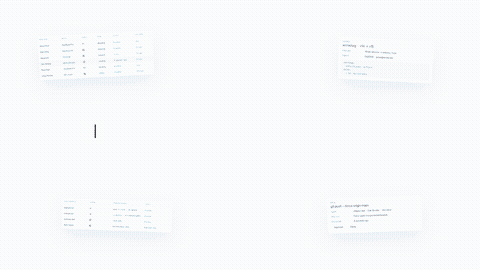
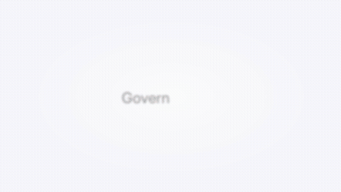
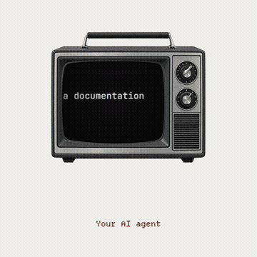
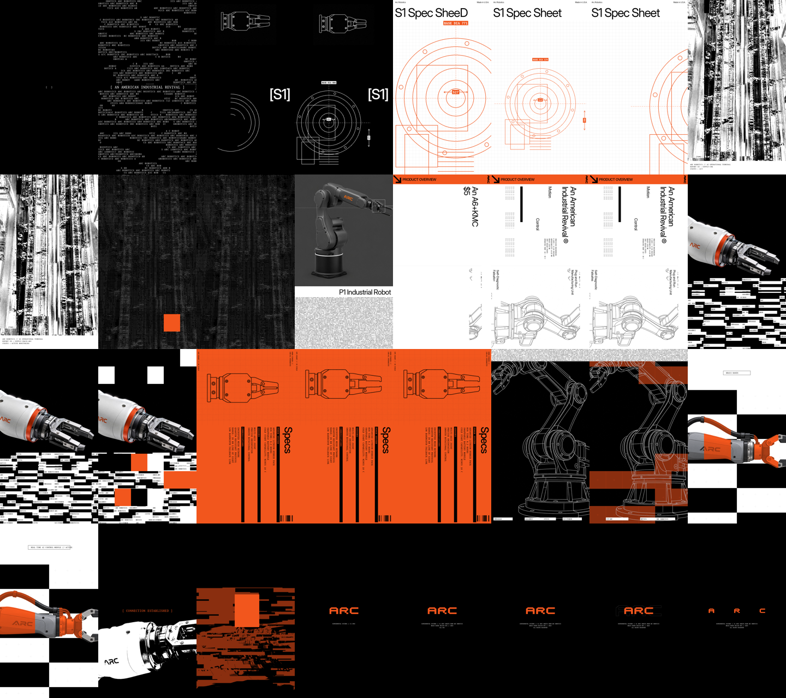

<div align="center">

# framesmith

**Motion-graphics, video and visual-design skills for AI coding agents.**
Brief in, MP4 out. Deterministic Python + ffmpeg, optional gpt-image-2 assets, no browser.

Works with **Claude Code**, **Codex**, **Cursor**, **Gemini CLI**, and any agent that reads `SKILL.md`.


</div>

---

framesmith is a growing library of **agent skills** that turn a short JSON brief into a finished motion graphic: product promos, launch videos, animated spec sheets, kinetic typography and glitch/brutalist visuals. Each skill is a production-tested template. You or your agent swap in the brand, copy, colours and image prompts, review single frames, then render.

The skills share a tiny engine (`core/framesmith`) with a seekable timeline, exact easing curves, text-scramble and typewriter reveals, ASCII and word-mask fields, pixel-mosaic transitions, vector blueprints with counting dimensions, a wordmark generator for any brand name, and a gpt-image-2 asset pipeline with sprite-sheet support.

## Skills

<!-- catalog:start -->
| Skill | What it makes | Preview |
|---|---|---|
| [`blue-story-film`](skills/blue-story-film/SKILL.md) | Render a music-driven SaaS story film (about 60–90 s, 16:9) in the blue-light style. |  |
| [`brand-icons`](skills/brand-icons/SKILL.md) | Find, fetch, preview and credit real brand/logo SVG icons from thesvg.org (7,400+ marks, e.g. | — |
| [`brutalist-product-promo`](skills/brutalist-product-promo/SKILL.md) | Render a 22-second brutalist / industrial product promo video (spec-sheet motion graphics) for any hardware, device, robot, drone, vehicle or tech product. |  |
| [`devtool-launch-video`](skills/devtool-launch-video/SKILL.md) | Render a 34-second 16:9 launch film for a developer tool, CLI, AI agent product or security product. |  |
| [`glass-saas-promo`](skills/glass-saas-promo/SKILL.md) | Render a bright, music-driven SaaS promo (about 30–40 s, 16:9) in the frosted-glass style: a lavender-white field, blue-to-violet gradients, gpt-image-2 glass 3D objects (shield, folder, check, sparkle, laptop), real pro |  |
| [`illustrated-explainer`](skills/illustrated-explainer/SKILL.md) | Render a narrated, flat-vector corporate explainer video (about 60–100 s, 16:9). |  |
| [`keynote-product-film`](skills/keynote-product-film/SKILL.md) | Render a 16:9 keynote-style product film (about 60–90 s, music-driven, no voiceover) in the clean Apple-event look. |  |
| [`narrated-collage-explainer`](skills/narrated-collage-explainer/SKILL.md) | Render a square (1080×1080), voiceover-driven explainer or founder-story video in a warm paper-white collage style. |  |
| [`no-ai-slop`](skills/no-ai-slop/SKILL.md) | Edit drafts into sharper, more human writing while preserving the writer's personal voice, or detect AI-slop patterns without rewriting. | — |
| [`video-to-template`](skills/video-to-template/SKILL.md) | Turn any reference video (a URL or file) into a reusable framesmith template and a finished video for the user's own brand. | — |
<!-- catalog:end -->

Plus [`framesmith`](skills/framesmith/SKILL.md), a start-here router that picks the right template and explains how to build new ones.

## Install

**Claude Code (plugin marketplace)**

```
/plugin marketplace add Ar9av/framesmith
/plugin install framesmith@framesmith
```

**Any agent (skills CLI)**

```bash
npx skills add Ar9av/framesmith                                   # pick skills interactively
npx skills add Ar9av/framesmith --skill brutalist-product-promo   # just one
```

**Manual:** copy `skills/<name>/` into your agent's skills folder (`~/.claude/skills/`, `.agents/skills/`, `.cursor/skills/`, …). Every skill is self-contained: it ships its own copy of the engine, fonts, example brief and placeholders.

Requirements: Python 3.9+, `pip install numpy pillow`, and `ffmpeg`. Add `OPENAI_API_KEY` if you want gpt-image-2 assets.

## Use it

Ask your agent:

> Make a brutalist product promo for **Volta Dynamics' V9 field drone**, lime accent, spec sheet style.

Or drive it yourself:

```bash
cd skills/brutalist-product-promo
python3 scripts/promo.py check  --brief examples/arc/brief.json
python3 scripts/promo.py assets --brief my/brief.json      # gpt-image-2 (low/medium quality)
python3 scripts/promo.py still  --brief my/brief.json 3.4 11.3
python3 scripts/promo.py render --brief my/brief.json --audio track.mp3
```

<p align="center"></p>

## Why framesmith

- **Agent-native.** Every template follows the same verbs (`check`, `assets`, `still`, `sheet`, `render`). Agents review frames as images before spending a full render.
- **Deterministic.** Each frame is a pure function of time, and randomness is hashed rather than drawn from a global generator. The same brief gives the same video, byte for byte, so diffs and iteration are cheap.
- **Lightweight.** It only needs numpy, Pillow and ffmpeg: no headless Chrome, React, GPU or cloud render farm. It runs in CI, in containers and on a laptop.
- **Brand-able.** Colours, copy, timing and imagery all live in the brief. Contrast-aware colours and a wordmark that fits any name mean a new brand doesn't break the layout.
- **AI assets done right.** gpt-image-2 prompts come per slot with explicit framing and background rules, cost-sane quality defaults, and sprite sheets for looping motion. Placeholders keep everything runnable without a key.

## Build your own template

```bash
python3 tools/new_skill.py kinetic-type-teaser "Kinetic typography teaser for ..."
python3 skills/kinetic-type-teaser/scripts/main.py still 0.5 2.0
```

Read [`skills/framesmith/SKILL.md`](skills/framesmith/SKILL.md) for how to recreate a reference video as a template, and [`references/engine.md`](skills/framesmith/references/engine.md) for the engine API. Contributions are welcome; see [CONTRIBUTING.md](CONTRIBUTING.md).

## Repo layout

```
core/framesmith/        engine (source of truth): timeline, easing, typography, fx, blueprint, wordmark, media
skills/<name>/          one self-contained skill per template (SKILL.md, scripts/, references/, examples/)
skills/framesmith/      router + authoring guide
tools/                  new_skill.py · sync_core.py · catalog.py · validate.py
docs/media/             previews
```

## Credits

Motion and craft rules draw on public skills by Emil Kowalski (animation), Jakub Krehel (type and colour), Replicate (image prompting), HeyGen HyperFrames (seekable HTML video) and Anthropic (canvas design), all found via [AI UX Playground](https://aiuxplayground.com/skills/category/visual-design/). See [docs/credits.md](docs/credits.md). Bundled fonts: Inter Display and Geist Mono (OFL-1.1), and Departure Mono (MIT).

## License

MIT © Arnav ([@Ar9av](https://github.com/Ar9av)). Example imagery was generated with gpt-image-2 for the fictional brand "ARC Robotics".
